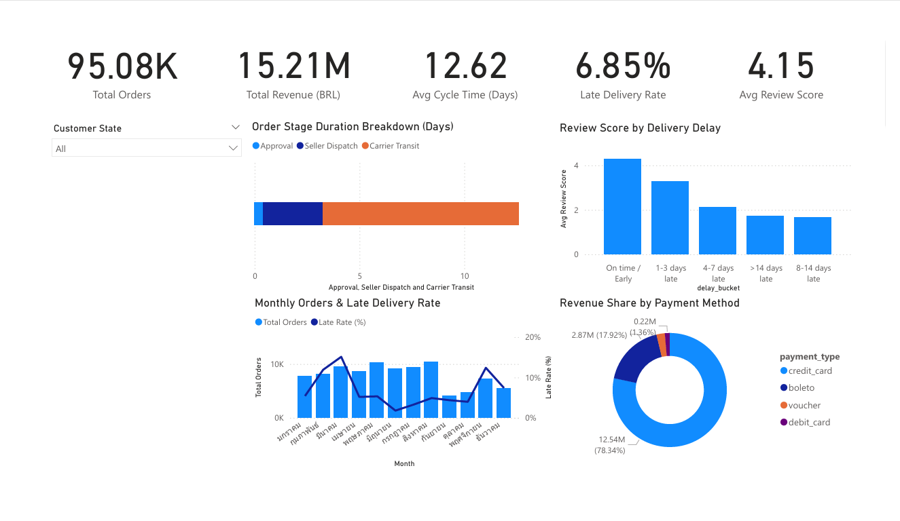
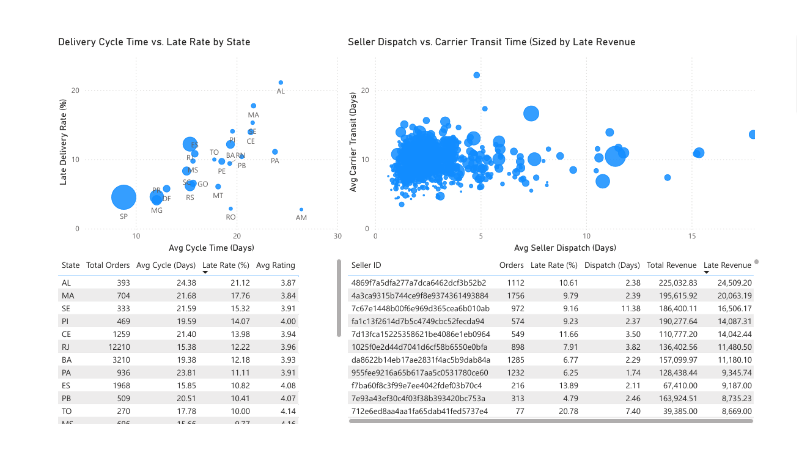

# O2C Process & Delivery Performance Analysis (Brazilian E-Commerce)

การวิเคราะห์ประสิทธิภาพกระบวนการ Order-to-Cash (O2C) และห่วงโซ่อุปทานโลจิสติกส์แบบครบวงจร (End-to-End) จาก Brazilian E-Commerce Public Dataset by Olist
เพื่อวินิจฉัยคอขวดเชิงเวลา ประเมินผลกระทบต่อความพึงพอใจของลูกค้า แยกแยะความเสี่ยงเชิงพื้นที่และรายผู้ขาย พร้อมออกแบบโมเดลข้อมูล Star Schema สำหรับการตัดสินใจเชิงธุรกิจบน Power BI

---

## ภาพรวมผลลัพธ์เชิงวิเคราะห์ (Executive Analytical Summary)

| ตัวชี้วัดหลัก (Core KPIs) | ค่าที่ได้ (Actual) | นัยสำคัญเชิงธุรกิจ (Analytical Implication) |
| :--- | :--- | :--- |
| Total Delivered Orders | 95,082 ออเดอร์ | ฐานข้อมูลคำสั่งซื้อที่ผ่านการตรวจสอบความถูกต้องของลำดับเวลา 100% |
| Gross Merchandise Value | 15.21 ล้าน BRL | รายได้หลักกระจุกตัวอยู่ที่การชำระผ่านบัตรเครดิต (78.34%) และ Boleto (17.92%) |
| Avg End-to-End Cycle Time | 12.62 วัน | เวลาเฉลี่ยตั้งแต่ลูกค้ากดสั่งซื้อจนได้รับสินค้าจริง |
| Late Delivery Rate (vs. SLA) | 6.85% | สัดส่วนออเดอร์ที่ส่งถึงมือลูกค้าช้ากว่าวันที่คาดการณ์ |
| Avg Customer Review Score | 4.15 / 5.00 | คะแนนความพึงพอใจโดยรวมซึ่งผันผวนตามความตรงต่อเวลาในการจัดส่ง |

---

## ผลการวิเคราะห์และข้อค้นพบสำคัญ (Key Analytical Findings)

### 1. ขั้นตอนไหนทำให้ส่งของช้าที่สุด? (คอขวดของการจัดส่ง)
เมื่อลองเอาเวลาส่งทั้งหมด 12.62 วัน มากางดูทีละขั้นตอน จะเห็นว่าเวลาส่วนใหญ่ไม่ได้เสียไปกับร้านค้าหรือระบบของเว็บ แต่ไปกองอยู่ที่บริษัทขนส่ง
* ขั้นตอนอนุมัติคำสั่งซื้อ (`days_to_approve`): ใช้เวลาเฉลี่ยไม่ถึงครึ่งวัน (~0.43 วัน หรือ 3.4%) ระบบตัดเงินและยืนยันออเดอร์ทำงานได้เร็วมาก
* ขั้นตอนร้านค้าแพ็กของ (`days_to_carrier`): ร้านค้าใช้เวลาเตรียมสินค้าและส่งมอบให้ขนส่งเฉลี่ย ~2.83 วัน (22.4%)
* ขั้นตอนขนส่งถึงมือลูกค้า (`days_to_customer`): กินเวลาเฉลี่ยสูงถึง ~9.36 วัน หรือคิดเป็น 74.2% ของเวลาทั้งหมด

> สรุปและแนวทางแก้ไข: ปัญหาความล่าช้าไม่ได้เกิดจากการทำงานภายในแพลตฟอร์ม แต่เกิดจากช่วงการขนส่งปลายทาง ดังนั้นการไปเร่งระบบอนุมัติออเดอร์แทบไม่ช่วยลดเวลาส่งรวม ควรโฟกัสไปที่การเจรจาต่อรองเวลาส่ง และปรับปรุงเส้นทางกระจายสินค้ากับบริษัทขนส่งเป็นหลัก

---

### 2. ส่งของสายแค่ไม่กี่วัน กระทบใจลูกค้าแค่ไหน?
เมื่อนำคะแนนรีวิวมาเทียบกับจำนวนวันที่ส่งช้า พบว่าลูกค้าให้ความสำคัญกับความตรงต่อเวลา
* ส่งตรงเวลาหรือส่งก่อนกำหนด : ลูกค้าให้คะแนนรีวิวเฉลี่ยสูงถึง 4.29 เต็ม 5
* ส่งช้า 1–3 วัน : คะแนนลดลงเหลือ 3.29
* ส่งช้า 4–7 วัน : คะแนนลดลงเหลือ 2.11
* ส่งช้าเกิน 7 วันขึ้นไป : คะแนนลดลงต่ำกว่า 2.00

> สรุปและแนวทางแก้ไข: จุดแตกหักอยู่ที่ 3 วันแรกที่เริ่มเลยกำหนดส่ง หากปล่อยให้ออเดอร์ล่าช้าโดยเงียบหายไป คะแนนร้านค้าจะเสียทันที ระบบควรแจ้งเตือนลูกค้าล่วงหน้าตั้งแต่วันแรกที่เริ่มส่งช้า พร้อมส่งคูปองส่วนลดปลอบใจอัตโนมัติเพื่อรักษาระดับความพึงพอใจไว้

---

### 3. ทำไมบางรัฐส่งนานมากแต่ไม่โดนด่า แต่บางรัฐส่งสายกระจุย?
จากการเปรียบเทียบเวลาส่งจริงกับอัตราส่งสายใน 24 รัฐหลัก พบความจริงที่น่าสนใจคือส่งนานไม่ได้แปลว่าส่งสายเสมอไป
* รัฐที่ส่งนานแต่บริหารความคาดหวังได้ดี : รัฐ Amazonas (`AM`) ซึ่งเป็นพื้นที่ห่างไกล ใช้เวลาจัดส่งเฉลี่ยสูงที่สุดในประเทศถึง 26.43 วัน แต่กลับมีอัตราส่งสายแค่ 2.78% และได้คะแนนรีวิวสูงถึง 4.26 เพราะระบบคำนวณเผื่อเวลาส่งไว้สมจริง ลูกค้ารู้ล่วงหน้าและยอมรับได้
* รัฐที่ผิดนัดส่งสูงมาก : รัฐ Alagoas (`AL`) และ Maranhão (`MA`) ใช้เวลาส่งจริง 24.38 วัน และ 21.68 วัน แต่กลับมีอัตราส่งสายสูงถึง 21.12% และ 17.76% ส่งผลให้คะแนนรีวิวร่วงลงเหลือ 3.87 และ 3.84

> สรุปและแนวทางแก้ไข: ปัญหาของรัฐ AL และ MA เกิดจากระบบประเมินวันส่งถึงสั้นเกินความเป็นจริง ทำให้ลูกค้าคาดหวังว่าจะได้ของเร็วกว่าที่ขนส่งทำได้ แพลตฟอร์มควรปรับสูตรคำนวณเผื่อเวลาส่งในโซนตะวันออกเฉียงเหนือให้ตรงกับความจริงมากขึ้น ควบคู่กับการตรวจสอบเส้นทางขนส่งในพื้นที่นั้น

---

### 4. ร้านค้ากลุ่มเสี่ยงที่ทำยอดขายหลุดมือ เกิดจากร้านแพ็กช้าหรือขนส่งช้า?
เมื่อคัดกรองร้านค้าที่ขายดีสม่ำเสมอ (30 ออเดอร์ขึ้นไป จำนวน 619 ร้าน)แล้วแยกดูว่าเวลาที่เสียไปเกิดจากร้านค้าแพ็กของช้า หรือเกิดจากบริษัทขนส่ง พบว่ากลุ่มร้านค้าที่มียอดขายตกอยู่ในความเสี่ยง (`Late Revenue`) สูงสุด แบ่งออกเป็น 2 ประเภทชัดเจน
* กลุ่มที่ร้านค้าทำงานเร็ว แต่ไปติดที่ขนส่ง : ร้านค้าอันดับ 1 และ 2 (`4869f7...` ยอดเงินเสี่ยง 24,509.20 BRL และ `4a3ca9...` ยอดเงินเสี่ยง 20,063.19 BRL) แพ็กของส่งให้ขนส่งไวมากภายใน 2.38 – 2.39 วัน แต่ของไปค้างอยู่ที่บริษัทขนส่งปลายทาง
* กลุ่มที่ร้านค้าเตรียมของช้าเอง : ร้านค้าอันดับ 3 (`7c67e1...` ยอดเงินเสี่ยง 16,506.17 BRL) ใช้เวลาเตรียมและแพ็กสินค้าเองนานเฉลี่ยถึง 11.38 วัน กว่าจะส่งของออกจากร้านได้

> สรุปและแนวทางแก้ไข: แพลตฟอร์มไม่ควรใช้บทลงโทษแบบเดียวกันกับทุกร้านค้าที่ส่งสาย แต่ควรแยกจัดการตามต้นตอปัญหา คือ (1) ออกกฎคุมเข้มเวลาเตรียมสินค้า สำหรับร้านที่แพ็กของช้าเกิน 5 วัน และ (2) จัดหาขนส่งทางเลือกหรือช่องทางส่งด่วนให้ร้านค้ายอดขายสูงที่แพ็กของตรงเวลาแต่ติดปัญหาขนส่งปลายทาง
---

## Power BI Interactive Dashboard (`./PowerBI`)

### O2C Overview — ภาพรวมกระบวนการ คอขวด และผลกระทบต่อรีวิว

*(หากชื่อไฟล์ภาพในโฟลเดอร์ `PowerBI/` ต่างจากนี้ สามารถแก้ไขชื่อไฟล์ในวงเล็บด้านบนได้เลยครับ)*

### State & Seller Risk — เจาะลึกความเสี่ยงรายรัฐและผู้ขายกลุ่มเสี่ยง

---

## แนวคิดและขั้นตอนการทำ Data Pipeline (Data Engineering & Cleaning)

### 1. Data Ingestion & Schema Parsing
- แปลงคอลัมน์เวลาทั้งหมด 5 คอลัมน์ (`order_purchase_timestamp`, `order_approved_at`, `order_delivered_carrier_date`, `order_delivered_customer_date`, `order_estimated_delivery_date`) ให้เป็นชนิดข้อมูลเพื่อให้รองรับการคำนวณความต่างของเวลา 

### 2. Business Filtering & Missing Value Handling
- กรองเฉพาะคำสั่งซื้อที่มีสถานะ `order_status == 'delivered'` เนื่องจากออเดอร์ที่ถูกยกเลิก หรือกำลังจัดส่ง ยังไม่สิ้นสุดกระบวนการ Order-to-Delivery
- ลบแถวที่มีค่าว่าง (Missing / NaN) ใน 4 จุดเวลาหลัก เพื่อป้องกันข้อผิดพลาดทางคณิตศาสตร์ในการคำนวณ Stage Duration

### 3. Duration Feature Engineering & Data Validation
- แปลงผลต่างของเวลาให้เป็นหน่วย "วัน" โดยคำนวณผ่านค่าวินาทีรวม (`.dt.total_seconds() / 86400`)
- Data Validation: ลบแถวข้อมูลที่ระยะเวลาติดลบ ($< 0$) ซึ่งเกิดจากระบบบันทึกเวลาผิดพลาด
- Date Normalization: ใช้ `.dt.normalize()` ในการเปรียบเทียบ `delay_days` เพื่อตัดเศษเวลาชั่วโมง/นาที/วินาทีออก และเปรียบเทียบความล่าช้าในระดับวันที่อย่างเป็นธรรม

### 4. Aggregation & Anti-Duplication Safeguards
- รวมคะแนนรีวิวต่อ 1 `order_id` ก่อนทำการเชื่อมโยงตาราง เพื่อป้องกันปัญหา Row Multiplication จากกรณีที่ลูกค้า 1 คนรีวิวสินค้าหลายชิ้นในออเดอร์เดียวกัน
- รวมยอดขายเฉพาะสินค้าของผู้ขายรายนั้นในแต่ละออเดอร์ (`groupby(["seller_id", "order_id"])`) ก่อนนำไปคำนวณมูลค่ายอดเงินที่ตกอยู่ในความเสี่ยง เพื่อไม่ให้เกิดปัญหานับยอดเงินซ้ำซ้อน

---

